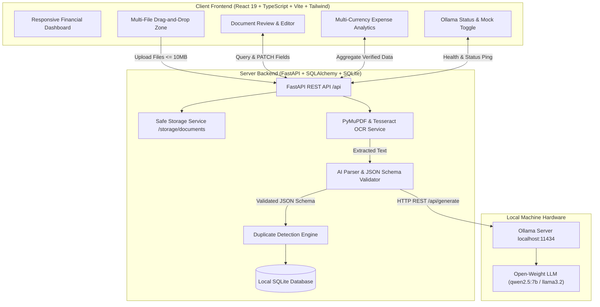

# InvoicePilot AI — Intelligent Local-First Financial Document Organizer

[](LICENSE)
[](#hacktoberfest-week-2-side-hustle-alignment)
[](https://python.org)
[](https://vitejs.dev)
[-purple.svg)](https://ollama.com)

> **Less paperwork. Fewer manual entries. More control over financial documents.**  
> Designed for freelancers, solo contractors, and small business owners who need to organize invoices and receipts without cloud subscription fees or sending sensitive bank records to third-party AI APIs.

---

## 1. Problem & Target Users

Small businesses and freelancers spend hours every month manually transcribing vendor names, dates, tax amounts, and totals from scattered PDF invoices and receipt photos into spreadsheets. Existing commercial solutions either charge hefty monthly subscriptions per user or transmit sensitive receipts to proprietary cloud AI providers.

**InvoicePilot AI** solves this by delivering an open-source, local-first document processing pipeline:
- Upload invoices or receipt photos (PDF, PNG, JPG).
- Extract structured financial data using local OCR and open-weight LLMs via Ollama.
- Automatically categorize expenses into practical tax buckets.
- Detect exact and potential duplicate bills before you double-pay or double-deduct.
- Review and correct extracted numbers in a streamlined verification interface.
- Export clean, formula-injection-safe CSV files for bookkeeping and tax preparation.

---

## 2. Architecture Overview



---

## 3. Key Features

- **Local-First AI Extraction**: Runs locally on CPU/GPU via Ollama. Structured extraction using Pydantic JSON validation ensures clean numerical outputs (vendor, invoice #, dates, currency, subtotal, tax, total, and description).
- **Hybrid OCR Pipeline**: High-speed direct text extraction for digital PDFs via PyMuPDF; seamless fallback to Tesseract OCR for scanned documents and smartphone photos.
- **Smart Duplicate Detection**: 
  - **Exact Hash Match**: Computes SHA-256 binary hash to pinpoint identical files.
  - **Metadata Heuristic Match**: Detects matches on Vendor + Invoice Number or Vendor + Date + Amount.
- **Human-in-the-Loop Review**: Shows confidence pills for extracted fields and allows 1-click edits before finalizing.
- **Multi-Currency Analytics**: Tracks USD, EUR, GBP, and others separately. Never combines disparate currencies into misleading totals.
- **Safe CSV Export**: Sanitizes cell contents against spreadsheet formula injection attacks (`=`, `@`, `+`, `-`).
- **Offline Mock Mode**: Built-in regex heuristic extractor allowing automated testing and evaluation without downloading multi-gigabyte models.

---

## 4. Technology Stack

| Layer | Technologies |
|---|---|
| **Frontend** | React 19, TypeScript, Vite, Tailwind CSS, React Router v7, Lucide React |
| **Backend** | Python 3.11+, FastAPI, Pydantic v2, SQLAlchemy 2.0, SQLite |
| **Document Processing** | PyMuPDF (fitz), Pillow, pytesseract |
| **AI Inference** | Ollama (`qwen2.5:7b`, `qwen2.5:3b`, or compatible open-weight model) |
| **Testing** | pytest, pytest-asyncio, Vite production build |

---

## 5. Prerequisites

1. **Python 3.11, 3.12, or 3.13** installed and added to `PATH`.
2. **Node.js 18+** and `npm` installed.
3. *(Optional for live LLM)* **Ollama** installed from [ollama.com](https://ollama.com).
4. *(Optional for scanned image OCR)* **Tesseract OCR** (on Windows: installer available via UB-Mannheim/tesseract).

---

## 6. Windows Quickstart Guide

Open PowerShell in the project directory (`InvoicePilot-AI`):

### Step 1: Clone and Configure Environment

```powershell
# Copy environment configuration
Copy-Item .env.example .env
```

Review `.env`:
```env
PORT=8000
HOST=127.0.0.1
DATABASE_URL=sqlite:///./storage/invoicepilot.db
STORAGE_DIR=./storage/documents
OLLAMA_BASE_URL=http://localhost:11434
OLLAMA_MODEL=qwen2.5:7b
MOCK_AI=false
```

### Step 2: Install Backend Dependencies

```powershell
python -m pip install -r backend/requirements.txt
```

### Step 3: Run Backend Tests

Run the automated test suite (uses isolated SQLite databases and mock mode):

```powershell
python -m pytest backend/tests -v
```

### Step 4: Install Frontend Dependencies & Build

```powershell
cd frontend
npm install
npm run build
cd ..
```

---

## 7. Running the Application

### Option A: Using Ollama for Local AI

1. Start Ollama and download the recommended model:
   ```powershell
   ollama pull qwen2.5:7b
   ```
   *(Or for lightweight hardware: `ollama pull qwen2.5:3b`)*

2. Start the FastAPI backend:
   ```powershell
   python -m uvicorn backend.main:app --host 127.0.0.1 --port 8000 --reload
   ```

3. In a second PowerShell terminal, start the frontend dev server:
   ```powershell
   cd frontend
   npm run dev
   ```

4. Open your browser at `http://localhost:5173`.

### Option B: Running with Mock AI Mode (No Ollama Required)

If you do not have Ollama installed or are testing in a lightweight CI environment:
1. In `.env`, set `MOCK_AI=true`.
2. Start backend and frontend as shown above.
3. The UI will prominently indicate **Mock Mode Active** and extract fields using rule-based heuristics.

---

## 8. REST API Reference

| Method | Endpoint | Description |
|---|---|---|
| `GET` | `/api/health` | Health check endpoint |
| `GET` | `/api/ai/status` | Ollama connectivity, installed models, and mock state |
| `POST` | `/api/ai/toggle-mock` | Toggle mock AI mode on/off |
| `POST` | `/api/documents/upload` | Upload single or batch documents (PDF/JPG/PNG) |
| `GET` | `/api/documents` | List documents with search, category, status, and pagination |
| `GET` | `/api/documents/{id}` | Retrieve document details and extraction audit info |
| `GET` | `/api/documents/{id}/file` | Stream uploaded original document file |
| `PATCH` | `/api/documents/{id}` | Update extracted fields and review status |
| `POST` | `/api/documents/{id}/process`| Retry OCR and AI extraction pipeline |
| `DELETE` | `/api/documents/{id}` | Permanently delete record and stored file |
| `GET` | `/api/analytics` | Multi-currency expense aggregates and status metrics |
| `GET` | `/api/export/csv` | Download filtered records as CSV |

---

## 9. Privacy & Security Architecture

1. **Local-First Processing**: Documents never leave your machine. No calls are made to external commercial LLMs.
2. **Safe Storage**: Uploaded files receive internal UUID filenames to completely prevent path traversal and execution attacks.
3. **Strict Upload Guardrails**: Enforces 10 MB maximum file size and rejects executable extensions.
4. **SQL Injection Defense**: All database queries utilize SQLAlchemy 2.0 parameterized expressions.
5. **Formula Injection Sanitization**: Exported CSV cells beginning with dangerous characters (`=`, `+`, `-`, `@`) are prefixed with single quotes.

---

## 10. Hacktoberfest Week 2: Side Hustle Alignment

This project addresses the **Hacktoberfest Open-Source AI Challenge Week 2: Side Hustle**:
- **Solves a Real Economic Pain Point**: Freelancers and side-hustlers waste hours every tax season manually entering receipts or paying $20+/mo for accounting SaaS.
- **Open-Weight & Free**: Runs without paid API tokens using open-source models (Ollama).
- **Production-Ready Foundation**: Clean modular full-stack codebase with 100% passing automated tests.

---

## 11. Known Limitations & Roadmap

- **Multi-Page Image OCR**: Currently processes up to 5 pages of scanned PDFs for optimal local latency; future releases will support background queue workers for 50+ page tax binders.
- **Line-Item Split**: Currently extracts subtotal, tax, and overall total; itemized table extraction is planned for v1.1.
- **Custom Categorization Rules**: Future releases will allow users to define custom automated rule triggers (e.g. "Vendor containing Delta -> Travel").

---

## 12. License

This project is licensed under the [MIT License](LICENSE).
